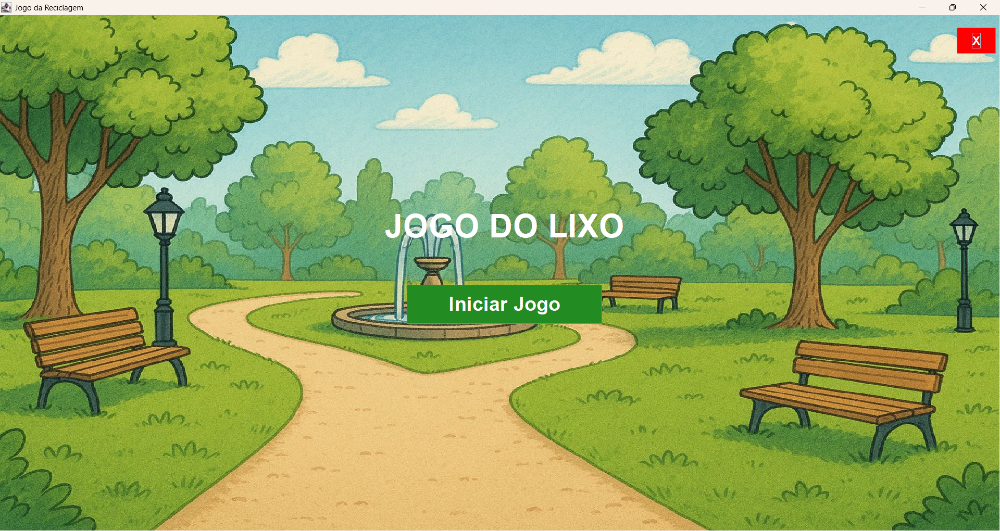
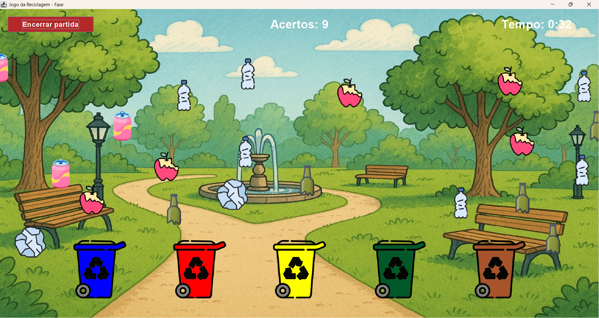
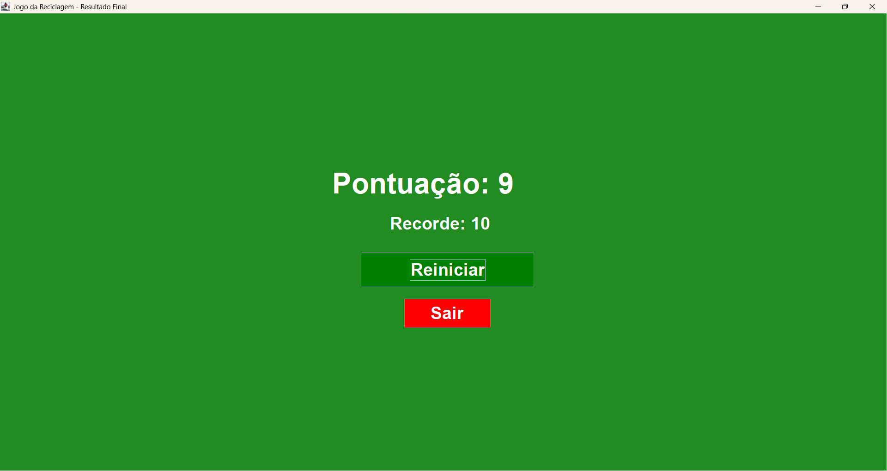

# Recycling Game ♻️

An educational recycling game developed in Java using Swing.

## About the Project

The Recycling Game is a desktop application designed to encourage environmental awareness through an interactive waste-sorting game.

Players must drag waste items into the correct recycling bins before time runs out.

## Screenshots

### Main Menu

### Gameplay

### Final Score

## Features

- Interactive drag-and-drop gameplay
- Five types of waste and corresponding recycling bins
- Countdown timer
- Score tracking
- Persistent high score
- Background music and sound effects
- Final score screen

## Technologies Used

- Java
- Java Swing
- Java AWT
- Java Sound API

## How to Run

1. Install a compatible Java Development Kit (JDK).
2. Open the project in a Java-compatible IDE, such as VS Code or Eclipse.
3. Ensure that the source files and resource files are in their expected locations.
4. Run the `JogoReciclagemGUI` class.

## Project Structure

- `src/` — Java source code.
- `resources/` — Images and audio files.
- `.gitignore` — Files excluded from version control.

## Future Improvements

- Add difficulty levels.
- Improve the user interface.
- Add new recycling challenges.

---

Developed as a Java learning and portfolio project.
